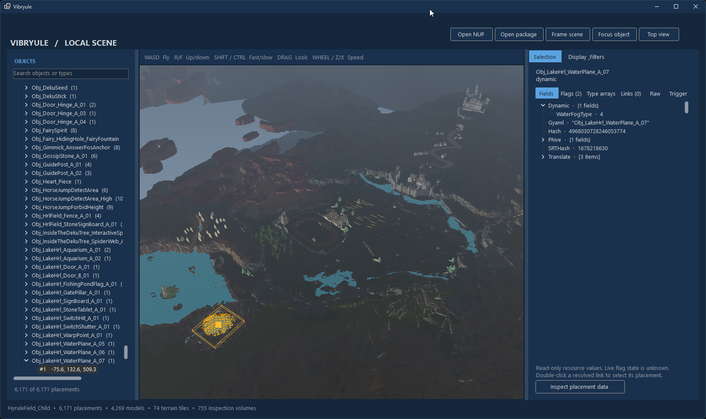

# Vibryule

A Windows 3D scene viewer for the Ocarina of Time remake. Explore terrain and objects from your own local NUP, inspect actor data, and follow placement links.

**This is a vibe-coded project by Ultimation and ChatGPT.** It is an experimental viewer, not an editor or emulator.

## Get started

1. Install the **[.NET 10 Desktop Runtime — Windows x64](https://dotnet.microsoft.com/en-us/download/dotnet/10.0)**.
2. Download the ZIP from [Releases](https://github.com/Ultimationzzz/Vibryule/releases), extract it to a writable folder, and run `Vibryule.exe`.
3. Click **Open NUP**, select your local file, and choose a scene. First-time preparation may take a few minutes.

Windows x64 and Direct3D 11 are required. The .NET runtime is **not bundled**. No game files are included or downloaded; all assets come from your NUP. The viewer does not modify it.

Your NUP path is saved in `config.json` beside the app and reopened at startup. Prepared scenes are cached under `%LOCALAPPDATA%\Vibryule\cache`.

## Explore and inspect

- **WASD:** fly; **R/F:** up/down; **Shift/Ctrl:** faster/slower.
- **Left/right drag:** look around; **middle drag:** pan; **wheel or Z/X:** change speed.
- **Click an object:** select and highlight it. **Home** or **Focus object:** frame selection. **T:** top view.
- Browse object types in the tree. The inspector shows typed fields, flag values/defaults, indexed arrays, placement links and raw data.
- **Extent names** filters model bounds and markers by actor or placement name; commas mean “or.” Enable **Also filter models** to hide other models, or **Pick extents instead of surfaces** to select boxes. Zone visibility has its own filters under Zones.
- Toggle terrain, game textures, lighting, bounds and area overlays independently. Double-click a resolved inspector link to select its destination.

The right panel has separate full-height **Selection** and **Display & Filters** tabs. Display controls are grouped into **Scene**, **Lighting** and **Zones**. Use **Clean**, **Inspect** or **Triggers** for a quick starting view. Lighting controls adjust the sun direction, intensity, ambient light, exposure and distance haze; wireframe is available under Scene.

Drag the divider on either side of the map to resize the object tree or inspector. Double-click a divider to restore its default width.

**Water shader** adds animated ripples, sky tint/reflection and waterfall streaks to identified water materials. Toggle or pause it under Scene; adjust ripple strength, opacity and speed under Lighting. This is a viewer effect, without scene reflections or refraction.

### Inspect triggers

1. Click **Triggers**, then use **Filter map zones by name** or the zone-type dropdown. These filter the map and list together, without hiding world models. Commas match either name. **Show all** resets zone filters; **Hide all** hides the overlay; **Isolate selected zone** shows only the selected actor's volumes. The count shows how many volumes remain on the map. Click a volume to select it or double-click a list entry to frame it.
2. Click **Open selection details**, or switch to **Selection → Trigger**, for stored conditions, event names, destination scenes, linked actors and shared logic-module references. Selecting zones keeps your filter tab open until you choose to inspect them.
3. Use **Probe at center**, or enable **Probe follows fly camera** and fly through a zone. Green outlines and the entry/exit list show which displayed volumes contain the probe. **Inspect zone when probe enters** opens its details automatically.

Toggle translucent fill, through-wall display, approximate volumes and selected-only display separately. Cyan volumes come from resource primitives or stored bounds; amber volumes are approximations. The inspector identifies the source of each volume.

**Death / fall candidates** and **Item fall zones** have separate visibility toggles with scene counts. **Only death / fall candidates** isolates the former; **Show all** resets the filter. These classifications use direct `FallDown` logic-module references, not generic actor names. They identify fall-contact candidates, not confirmed lethal volumes; the Trigger inspector shows the evidence.

These controls require version **1.1.0 or newer**; the original Release 1 download predates them.

## Current limits

Hyrule Field and Kokiri Forest are tested; other scenes and game versions may be incomplete. Rendering uses original textures with reconstructed lighting shaders, not the full game renderer. Water detection uses material names and may miss unrecognized surfaces. Some models, animation and materials are unsupported.

Model bounds describe render geometry. Zone inspection supports resource boxes/spheres, stored shape bounds and approximate placement extents. Full physics collisions, runtime transforms and AI execution are not decoded. The probe tests a point against the displayed volumes; it does **not** simulate a player or execute events. Event names and references show configured data, not proof that entering a zone will run an event. Live flags and activation conditions remain unknown.

## Build

Install the .NET 10 SDK on Windows, then run:

```powershell
dotnet build Vibryule.csproj
dotnet run --project tests/Vibryule.Checks.csproj
```

Parsing is C#. SpaceUI source is included; other dependencies restore from NuGet. See [test instructions](https://github.com/Ultimationzzz/Vibryule/blob/main/tests/README.md) for optional checks using local assets. Run `./publish.ps1` to create a framework-dependent release ZIP.

## License and credits

Vibryule uses the [PolyForm Noncommercial 1.0.0 license](LICENSE). Noncommercial use, modification and sharing are allowed with the required attribution to **Ultimation and ChatGPT**. Commercial use or sale requires separate permission. Third-party components retain their own licenses; see [CREDITS.md](CREDITS.md).

This is an unofficial project, unaffiliated with Nintendo. Game assets and trademarks belong to their respective owners.
